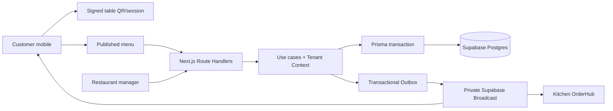

# Design: MVP ordering vertical slice

## Architecture overview

Route handlers own HTTP/session/input concerns. Use cases own authorization, validation and transactions. Prisma owns relational persistence. Supabase owns RLS, triggers and Broadcast. Realtime never replaces the persisted snapshot.

## Data models

Planned models for Marco 2:

- `restaurant_tables`: tenant, restaurant, stable table identity and active state.
- `table_sessions`: signed table/session identity, status, expiry and recovery reference.
- `menu_categories` and `menu_items`: published/available catalog with tenant ownership.
- `modifier_groups` and `modifiers`: server-validated options with min/max rules.
- `orders`: restaurant/table/session, status, totals, timestamps and correlation data.
- `order_items` and `order_item_modifiers`: immutable snapshots of names, prices and choices.
- `order_state_transitions`: actor, previous/next state, reason and concurrency evidence.
- Existing `idempotency_keys`, `outbox_events` and `audit_logs`: reused by the new aggregates.

Every sensitive row carries or derives `tenant_id`. Composite foreign keys preserve tenant/restaurant integrity. Order snapshots do not change when the catalog changes.

## API contracts

Names are provisional; invariants are binding.

### Resolve table/session

`GET /api/public/tables/{signedToken}` returns restaurant identity, table label, session identifier and published menu context. Invalid, expired, revoked or cross-tenant tokens are rejected. Internal IDs and secrets are not exposed unnecessarily.

### Read published menu

`GET /api/public/restaurants/{restaurantSlug}/menu` returns only published, active categories/items and valid modifiers. Client-provided price and availability are never trusted during order creation.

### Create order

`POST /api/public/orders` requires `Idempotency-Key`, scoped to tenant/endpoint/key. The request contains session reference, item IDs, modifier IDs and bounded notes. The server resolves tenant/table/session, validates catalog data, snapshots authoritative values, writes order and Outbox event in one transaction, and returns a stable order reference/status.

Stable errors cover invalid session, unavailable item, invalid modifier, conflict and retryable failure. Client totals are never authoritative.

### Kitchen order/status

- `GET /api/restaurants/{slug}/orders?status=...` requires staff membership and restaurant scope.
- `POST /api/restaurants/{slug}/orders/{orderId}/transitions` requires an allowed role and expected current state.
- A stale expected state returns conflict and the current snapshot; only the first valid concurrent transition wins.

### Realtime/resync

Private channels are scoped to tenant and restaurant. Events contain `event_id`, aggregate ID, event type/version and sequence. Clients deduplicate and resync the order snapshot after reconnect or a sequence gap.

## Component breakdown

### Domain/backend

- Order state machine and transition validator.
- Menu/session/order use cases.
- Tenant Context and membership authorization.
- Idempotency adapter.
- Prisma repositories/transactions.
- Outbox event adapter and audit writer.

### Frontend

- Public table/session resolver.
- Menu and cart components.
- Order confirmation/status view.
- Kitchen OrderHub with accessible status controls.
- Manager minimum table/menu controls.
- Loading, error, unavailable, retry and disconnected states.

New primitives must start from Smooth UI/shadcn-compatible components and use semantic tokens in `app/globals.css`.

## Design decisions

- Use a vertical slice rather than completing a UI surface in isolation.
- Keep customer access anonymous but signed and scoped to a table session.
- Validate prices, modifiers and availability only on the server.
- Use transaction + Outbox for order confirmation; Broadcast is notification only.
- Use optimistic concurrency for status transitions with persisted conflict handling.
- Defer payments, split, delivery, import and external queues.

## Non-functional requirements

- **Security:** RLS on every exposed table; no authenticated-only policy without ownership; no cross-tenant events; no secrets in URLs/logs.
- **Correctness:** order creation is idempotent; snapshots are immutable; transitions are deterministic.
- **Reliability:** Realtime loss delays updates but cannot corrupt state; reconnect performs resync.
- **Performance:** menu/status reads remain restaurant-scoped; order creation uses one short transaction.
- **Accessibility:** visible labels/focus, text and semantic status, mobile customer flow without an app.
- **Observability:** correlation ID, actor, tenant, aggregate, outcome and safe error code without sensitive payloads.
